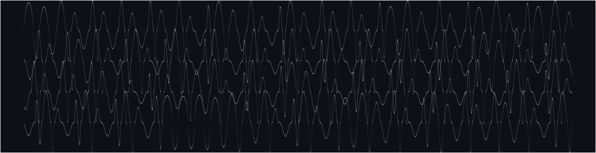

# Crossings

SuperCollider server plugins (UGens) that synthesize and shape sound at the level of the waveset: the span of signal between alternate zero crossings. A companion to [WavesetUGens](https://github.com/bjarnig/WavesetUGens), which ports CDP's waveset processes.

## UGens

- **`WsGen`**: generates wavesets whose length, peak, shape and zero-crossing position are read once per waveset, so demand-rate inputs advance one value per waveset.
- **`WsMap`**: each waveset is computed from the previous one through an iterated map (logistic, tent, sine, circle), from fixed pitch through periodic patterns to chaos.
- **`WsGendy`**: dynamic stochastic synthesis bounded by zero crossings; breakpoints of each half-cycle random-walk once per waveset.

## Build from source

```sh
./build.sh [path-to-supercollider-source]
```

Builds and installs into your user Extensions folder (`.../SuperCollider/Extensions/Crossings/`). Then recompile the class library (Cmd-Shift-L) and boot the server.

```supercollider
{ WsGen.ar(Dbrown(80, 900, 40), 0.3) ! 2 }.play;
```

Requires CMake 3.12 or later and a C++17 compiler. Builds against a SuperCollider source checkout matching the scsynth you run.

## License

GPL-3.0.
