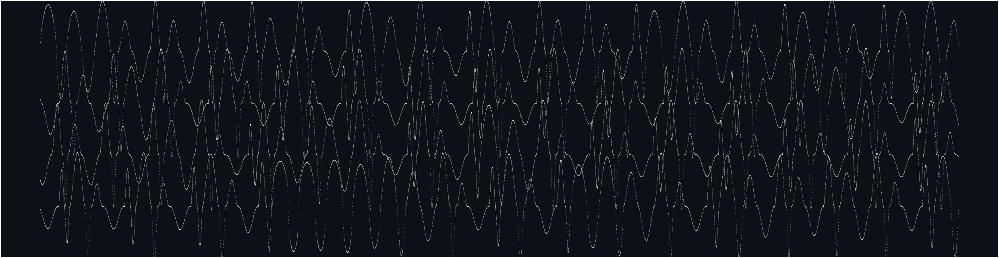

# Crossings

SuperCollider server plugins (UGens) for waveset synthesis. A waveset is the span of signal between alternate zero crossings. Crossings synthesizes the wavesets themselves.

Every parameter is read once per waveset, at the zero crossing. Demand-rate inputs (`Dseq`, `Dbrown`, `Dwhite`, ...) advance one value per waveset, and each waveset can have its own length, shape, peak and skew.

## UGens

- **`WsGen`**: wavesets with per-waveset length, peak, shape (sine, triangle, square, spike, morphable), skew, repeats and glide.
- **`WsMap`**: each waveset computed from the previous one through an iterated map (logistic, tent, sine, circle, standard, Ikeda). Fixed points give a steady pitch, periodic orbits repeating patterns, chaos rough streams. Optional hysteresis on the map parameter.
- **`WsGendy`**: Xenakis' dynamic stochastic synthesis bounded by zero crossings. The breakpoints of each half-cycle random-walk once per waveset.
- **`Dmap`**: the WsMap maps at demand rate, so one orbit can drive waveset parameters, `TDuty` rhythms or `DemandEnvGen` breakpoints, or a slower map can steer WsMap.
- **`WsGroup`**: groups of any number of half-cycles in place of wavesets of two. Odd counts, uneven lengths, decay and random sign flips give subharmonic and inharmonic results.
- **`WsSync`**: synthetic wavesets on the zero crossings of a live input, keeping its timing exactly, one waveset late, with optional skew and amplitude from the input.
- **`WsInfo`**: measures each waveset of a live input as it ends: frequency, peak, skew and a trigger.

The generators share two extras:

- **`arTrig`** returns `[sig, trig]`, with a trigger at the start of every `every`-th waveset, so the waveset clock can drive other UGens.
- **`balance`** scales the larger half-cycle so both halves enclose the same area, removing the DC offset that skewed wavesets produce.

## Install (prebuilt)

Download the archive for your OS from [Releases](https://github.com/bjarnig/Crossings/releases), extract the `Crossings/` folder into your SuperCollider Extensions folder, then recompile the class library (Cmd/Ctrl-Shift-L) and reboot the server. Binaries target SuperCollider 3.12 to 3.14.x (plugin API v3). On macOS, clear the download quarantine: `xattr -dr com.apple.quarantine <extracted Crossings folder>`.

## Credits & license

The waveset follows Trevor Wishart's definition, and `WsGendy` follows Iannis Xenakis' GENDYN. Licensed under **GPL-3.0** (see [`LICENSE`](LICENSE)).
