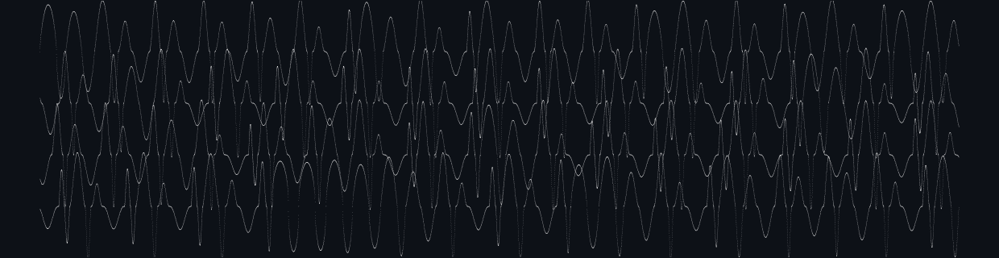

# Crossings

SuperCollider server plugins (UGens) for waveset synthesis. A waveset is the span of signal between alternate zero crossings. Crossings synthesizes the wavesets themselves.

Every parameter is read once per waveset, at the zero crossing. Demand-rate inputs (`Dseq`, `Dbrown`, `Dwhite`, ...) advance one value per waveset, and each waveset can have its own length, shape, peak and skew.

## UGens

- **`WsGen`**: wavesets with per-waveset length, peak, shape and skew.
- **`WsMap`**: each waveset computed from the previous one through an iterated map.
- **`WsGendy`**: Xenakis' dynamic stochastic synthesis bounded by zero crossings.
- **`Dmap`**: the WsMap maps at demand rate.
- **`WsGroup`**: groups of any number of half-cycles.
- **`WsNest`**: wavesets made of smaller wavesets, several levels deep.
- **`WsHear`**: WsMap whose orbit is bent by the wavesets it hears.
- **`WsSync`**: synthetic wavesets on the zero crossings of a live input.
- **`WsInfo`**: measures each waveset of a live input.

See the help files for details and examples.

## Install (prebuilt)

Download the archive for your OS from [Releases](https://github.com/bjarnig/Crossings/releases), extract the `Crossings/` folder into your SuperCollider Extensions folder, then recompile the class library (Cmd/Ctrl-Shift-L) and reboot the server. Binaries target SuperCollider 3.12 to 3.14.x (plugin API v3). On macOS, clear the download quarantine: `xattr -dr com.apple.quarantine <extracted Crossings folder>`.

## Credits & license

The waveset follows Trevor Wishart's definition, and `WsGendy` follows Iannis Xenakis' GENDYN. Licensed under **GPL-3.0** (see [`LICENSE`](LICENSE)).
